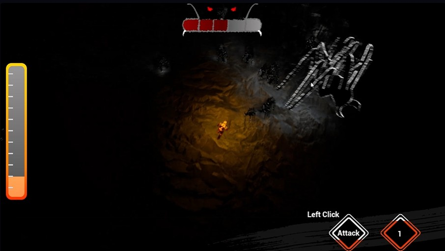
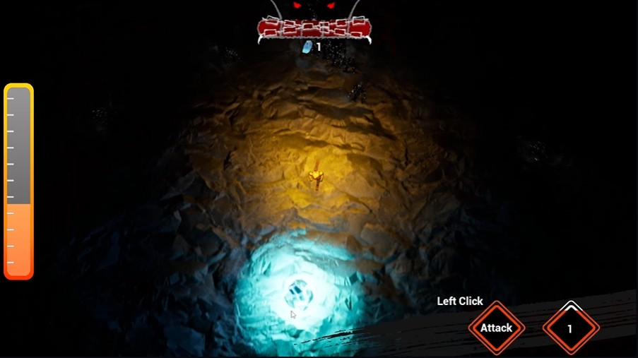
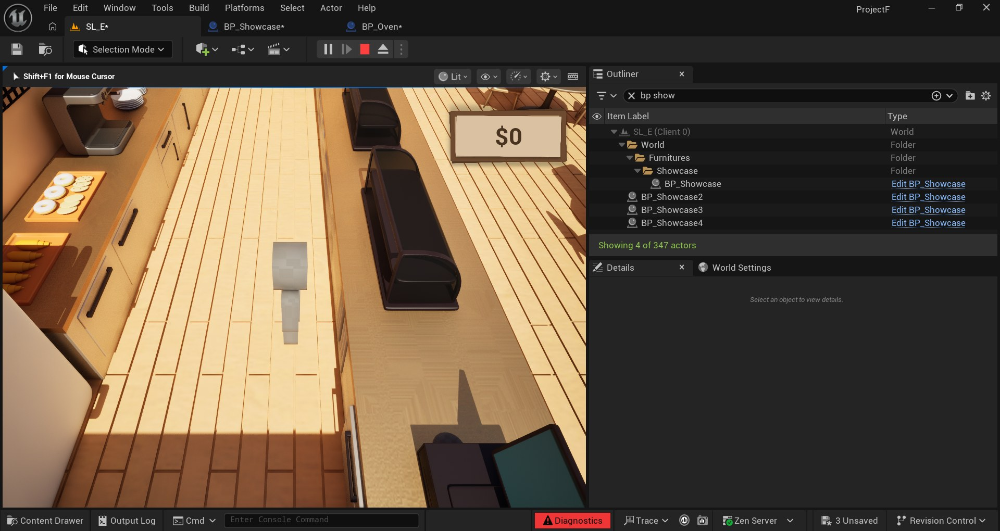
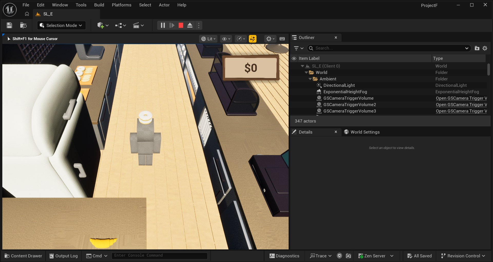
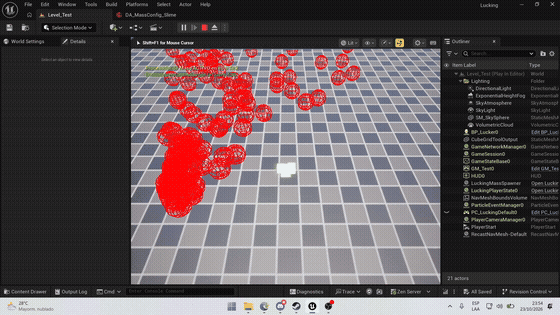
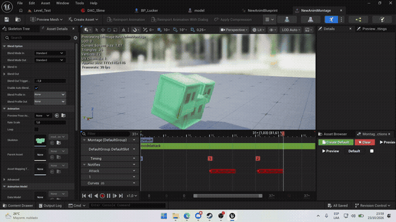
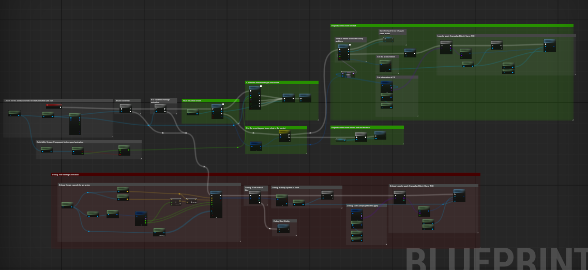

# Hey, I'm Eduardo! 👋
### Unreal Engine C++ Gameplay & Systems Programmer
**Santo Domingo, Dominican Republic (UTC-4 / EST) · Open to Remote Indie & Co-Dev Roles**

---

### What I Do

I build gameplay systems and multiplayer netcode in Unreal Engine 5. 

I really enjoy digging into engine internals to understand how things work under the hood. Most of my work revolves around solving the tricky problems things like client-side prediction, custom locomotion with the new Mover component, physics desyncs, and GAS replication. 

At the same time, I believe deep tech is only useful if the rest of the team can actually use it. Whenever I build a system, my priority is making sure 3D artists, designers, and animators can plug their work in through clean DataAssets and visual tools without needing to touch C++ or wait on code rebuilds.

---

#### ⚔️ [Keep Your Light (KYL)](https://thelastbonny.itch.io/keep-your-light)
*Top-Down Action Survival Game · Epic MegaJam 2025*

  
  

A complete action survival game I solo-developed from scratch and shipped within the tight deadlines of the 2025 Epic MegaJam.

* **The Combat Loop:** Fast-paced arena combat where you manage your light energy while fighting off shadowy creature waves.
* **Multi-Phase Boss Encounter:** Scripted a challenging final boss with telegraphed attack patterns, bullet-hell projectile spreads, and distinct combat phases.
* **Modular Systems:** Programmed an entity-agnostic health, hit-reaction, and stamina management system with responsive UI feedback in UMG.

🎬 **[Watch Gameplay Video on YouTube](https://www.youtube.com/watch?v=9_uo31k7VyI)**  
🎮 **[Play Keep Your Light for free on Itch.io](https://thelastbonny.itch.io/keep-your-light)**

---

### Featured Projects

#### 🎮 [ProjectF (Good Service)](https://github.com/TheLastBonny/Good-Service-PlaceHolder-Public-W.I.P)
*Multiplayer Service & Cooking Framework in Unreal Engine 5.8*

  
  

This was my undergraduate thesis project at ITLA, where I served as the sole programmer on a 3-person team alongside a 3D artist and an audio designer. We put over 580 hours into testing how far we could take modern UE 5.8 architectures by moving away from monolithic Blueprints into modular, data-driven systems.

* **Networked Movement & Prediction:** Configured the Chaos Mover 2.0 component with the Network Prediction plugin, writing custom sync states (`FMoverSyncState`) to deliver smooth client prediction and server authoritative rollback reconciliation.
* **Direct GAS Binding:** Connected Gameplay Ability System attribute delegates (like movement speed and stamina drain) directly into Mover locomotion parameters, eliminating tick polling.
* **Asynchronous Artist Pipeline:** Designed a flexible entity and station pipeline (`AGSItem`, `UGSItemDataAsset`, `GSUtilityStation`). This allowed our artist and musician to add new items, animations, and sound triggers completely asynchronously without blocking code or causing Git merge conflicts.
* **Autonomous Customers with StateTree:** Built an AI customer loop using StateTree and SmartObjects to handle dynamic table queues, ordering, and food pickup.

👉 **[Check out the ProjectF GitHub Repository & Technical Docs](https://github.com/TheLastBonny/Good-Service-PlaceHolder-Public-W.I.P)**

---

#### ⚡ [Lucking](https://github.com/TheLastBonny/Lucking)
*Mass Entity (ECS) Crowd Simulation & GAS Combat Framework in UE 5.8*

  
  

When you want massive hordes on screen, standard Character actors with full Ability System Components (ASCs) will choke the game thread. In Lucking, I set out to decouple the problem into two complementary systems:

* **Mass Entity (ECS) Horde Processing:** Wrote `LuckingMassProcessor` and `LuckingMassFragment` to execute parallel queries across CPU archetype chunks. In the technical preview above, 250+ entities are evaluated in real-time with zero game thread stutters.
* **Custom Async Melee Sweep in GAS:** Rather than basic Blueprint overlaps, I engineered `AbilityTask_WaitMeleeSweep` in C++. Custom AnimNotify events (`BP_NotifyPers`) trigger the sweep window along weapon sockets, prevent duplicate hits on the same target during a single swing, and apply GameplayEffects through the target's ASC.

  
   
  <em>The complete GAS melee ability graph in Lucking: cosmetic cues, AnimNotify listeners, sweep collision, and ASC effect delegation.</em>

👉 **[Explore the Lucking Codebase & Architecture Docs](https://github.com/TheLastBonny/Lucking)**

---

### What I Work With Daily

* **Engines:** Unreal Engine (5.5 / 5.8), Roblox Studio (Luau)
* **Languages:** C++ (Modern C++20), Blueprints, Lua, Python, C#
* **Systems & Architecture:** Chaos Mover 2.0, Network Prediction Plugin, Gameplay Ability System (GAS), StateTree, SmartObjects, Mass Entity (ECS), CommonUI
* **Workflow & Tools:** Git / GitHub, Perforce (P4), Visual Studio 2022, Blender, Unreal Build Tool

---

### Let's Connect!

I am always happy to chat about gameplay architecture, networking experiments, or indie game development in general.

* 💼 **LinkedIn:** [linkedin.com/in/thelastbonny](https://www.linkedin.com/in/thelastbonny/)
* 🎮 **Itch.io:** [thelastbonny.itch.io](https://thelastbonny.itch.io)
* ✉️ **Email:** [eduardoomjavier@gmail.com](mailto:eduardoomjavier@gmail.com)
