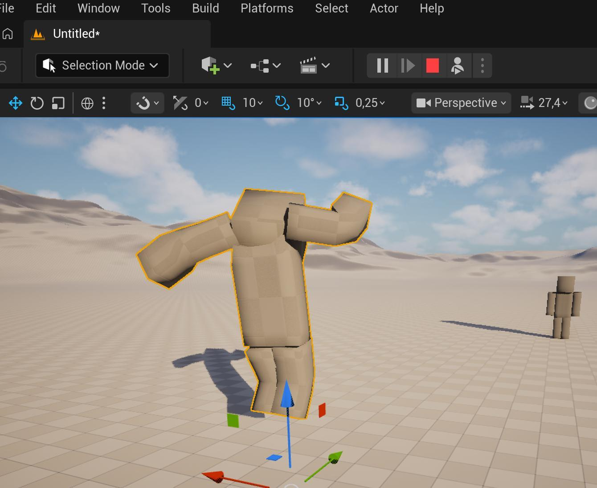

<div align="center">

# Eduardo Javier Oran Mejia
### Unreal Engine C++ Gameplay & Systems Programmer

[](https://www.unrealengine.com/)
[](https://isocpp.org/)
[](https://thelastbonny.itch.io)
[](https://www.linkedin.com/in/thelastbonny/)
[](mailto:eduardoomjavier@gmail.com)

**Santo Domingo, Dominican Republic (UTC-4 / AST · EST Aligned)**  
*Available for Worldwide Remote Roles (Independent B2B Contractor)*

</div>

---

### 👨‍💻 About Me

I am a **Systems and Gameplay Programmer** specializing in Unreal Engine 5. My work bridges low-level engine mechanics—such as networked locomotion, custom sync states, and Mass Entity—with clean, intuitive designer workflows using the Gameplay Ability System (GAS) and modular DataAssets.

> *"I engineer robust technical foundations so that artists, designers, and audio creators can bring worlds to life without fighting engine friction or fragile inheritance trees."*

* ⚡ **Core Focus:** Network Prediction, Custom Mover Components, GAS Replication, and Data-Driven Architecture.
* 🤝 **Multidisciplinary Leadership:** Proven experience leading technical architecture in 3-person teams (Programmer + 3D Artist + Sound Designer) with asynchronous, conflict-free pipelines.
* 🌐 **Languages:** Spanish (Native), English (Professional Working Proficiency).

---

### 🚀 Featured Projects

#### 1. [ProjectF (Good Service)](https://github.com/TheLastBonny/Good-Service-PlaceHolder-Public-W.I.P) — *Modular Multiplayer Gameplay Framework*
> **Role:** Lead Systems & Gameplay Programmer (580+ Engineering Hours · 111 C++ Classes)  
> **Tech Stack:** Unreal Engine 5.8, Modern C++, Chaos Mover 2.0, Network Prediction Plugin, GAS, StateTree

<p align="center">
  
</p>

* **Networked Locomotion:** Engineered custom kinematic movement atop UE5's Mover 2.0 and Network Prediction plugin (`FMoverSyncState`), achieving seamless client-side prediction and server reconciliation with independent ticking policies.
* **GAS Integration:** Bound dynamic locomotion properties (sprint, stamina decay, walk speed) directly to Gameplay Attributes via C++ delegates, eliminating polling overhead.
* **Data-Driven Artist Pipeline:** Architected modular DataAssets (`UGSItemDataAsset`, `AGSItem`) and stations (`GSUtilityStation`), enabling our 3D artist and audio designer to implement new assets, animations, and sound triggers without code recompilation or merge conflicts.
* **Autonomous AI with StateTree:** Designed NPC customer simulation using StateTree and SmartObjects to handle orders, seating queues, and table interactions.

<p align="center">
  <a href="https://github.com/TheLastBonny/Good-Service-PlaceHolder-Public-W.I.P"><b>[📂 Explore GitHub Repository]</b></a> • 
  <a href="https://github.com/TheLastBonny/Good-Service-PlaceHolder-Public-W.I.P#technical-deep-dive"><b>[📖 Architecture Documentation]</b></a>
</p>

---

#### 2. [Keep Your Light](https://thelastbonny.itch.io/keep-your-light) — *Solo Action Survival (Epic MegaJam 2025)*
> **Role:** Solo Developer (Systems, Combat Mechanics, AI, UI, Shipping)  
> **Tech Stack:** Unreal Engine 5, C++, State-Driven Combat, AI Boss Mechanics, UMG

* Designed, programmed, and shipped a complete action-survival title under strict game jam constraints.
* Built modular hit-detection, stamina management, dynamic projectile physics, and telegraphed multi-phase boss attack patterns in C++.
* Shipped a standalone playable build for PC on Itch.io.

<p align="center">
  <a href="https://thelastbonny.itch.io/keep-your-light"><b>[🎮 Play on Itch.io]</b></a>
</p>

---

#### 3. Lucking (Experimental Prototype) — *Mass Entity (ECS) & GAS Convergence*
> **Research & Performance Sandbox**

* Explored high-density entity simulation in UE5 using **Mass Entity (ECS)**, writing parallel `MassProcessors` and `MassFragments` for cache-friendly memory layouts.
* Constructed a lightweight bridging interface that allows individual Mass entities to signal events into the Gameplay Ability System without breaking CPU chunk locality.

---

### 🧰 Technical Competencies

| Category | Skills & Implementations |
| :--- | :--- |
| **Engine & Programming** | Unreal Engine 5.5 / 5.8, Modern C++ (C++20), Object-Oriented & Data-Oriented Design (POD/DOD) |
| **Locomotion & Netcode** | Chaos Mover 2.0, Network Prediction Plugin, Client Prediction, Rollback/Replay Reconciliation, Replication |
| **Gameplay Systems** | Gameplay Ability System (GAS), GameplayEffects, GameplayCues, AttributeSets, StateTree, SmartObjects |
| **Tooling & Designer UX** | DataAssets, Subsystem Architecture, CommonUI, UMG, Slate Basics, MetaSounds integration |
| **Workflow & VCS** | Git, GitHub, Perforce (P4), Asynchronous Pipeline Creation, Visual Studio 2022 |

---

### 📊 Engineering Philosophy & Metrics

```
  580+ Hours          111 C++ Classes       0 Merge Conflicts
  In-Engine Dev       Clean Architecture    Across 3-Person Team
```

* **Build Quick, Build Strong:** Rapid prototyping with DataAssets and C++ interfaces so systems can be tested immediately without technical debt.
* **Separation of Concerns:** Keep simulation logic strictly decoupled from visuals and audio, facilitating easy updates for artists.

---

### 📬 Contact & Links

* 🎮 **Playable Games:** [thelastbonny.itch.io](https://thelastbonny.itch.io)
* 💼 **LinkedIn:** [linkedin.com/in/thelastbonny](https://www.linkedin.com/in/thelastbonny/)
* 📂 **GitHub:** [github.com/TheLastBonny](https://github.com/TheLastBonny)
* ✉️ **Direct Email:** [eduardoomjavier@gmail.com](mailto:eduardoomjavier@gmail.com)
